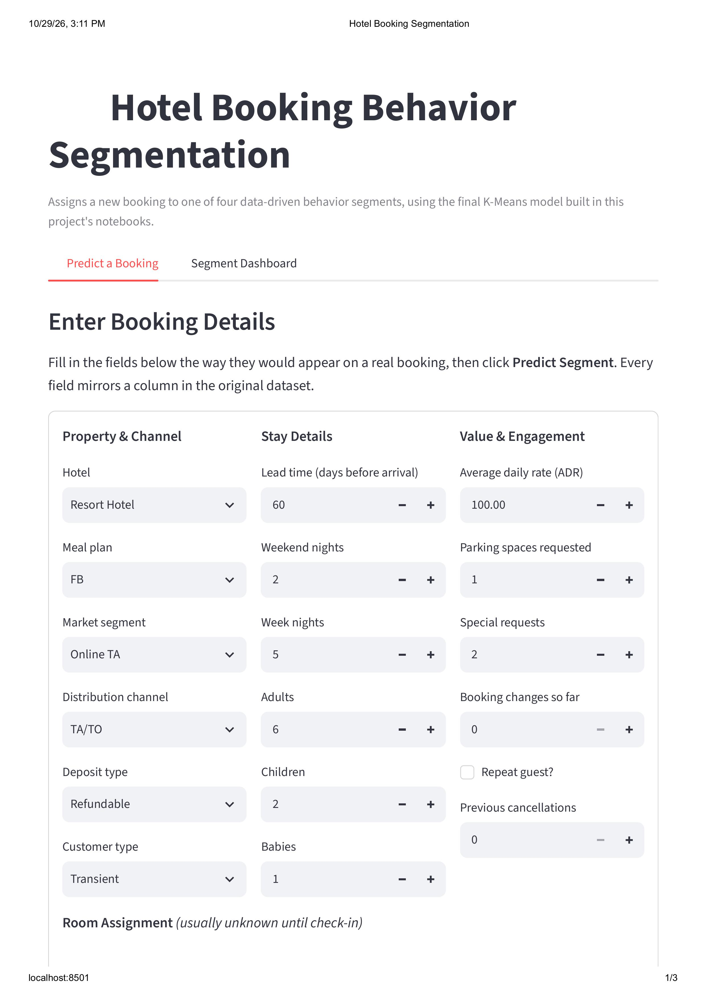
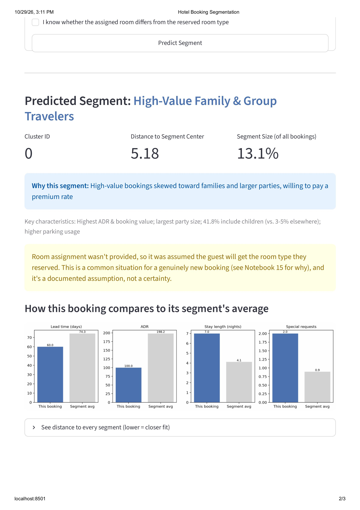
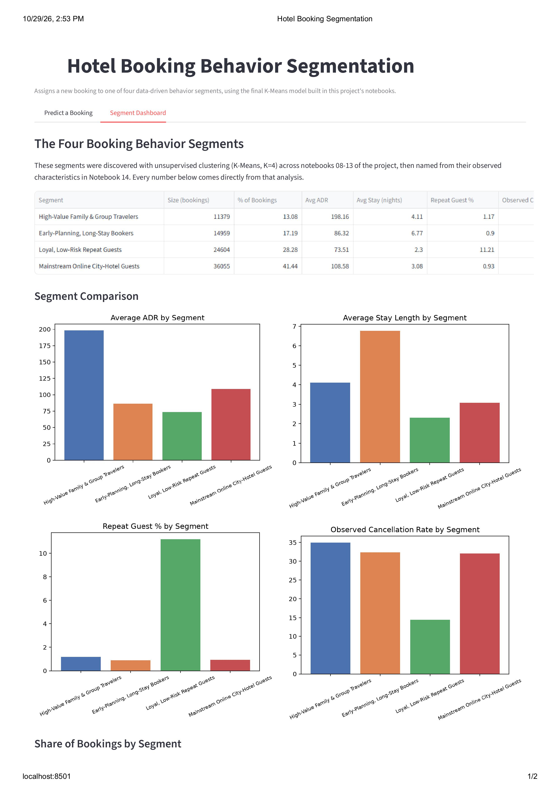
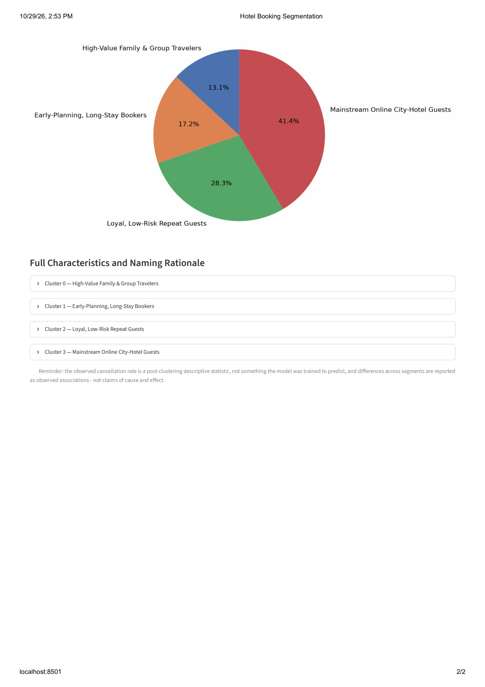

# Hotel Booking Behavior Segmentation

Unsupervised machine learning project that discovers naturally occurring booking-behavior
segments in a hotel's historical reservation data, using K-Means, Agglomerative (Ward)
clustering, and DBSCAN/HDBSCAN, following the CRISP-ML(Q) methodology end to end — from raw
data to a deployed Streamlit prediction app.

**Final result:** 4 evidence-based segments (K-Means, K=4), covering 100% of bookings with
0% noise, selected through a transparent weighted decision framework rather than a single
metric.

---

## Table of Contents

- [Project at a Glance](#project-at-a-glance)
- [Quick Start: Try the App in 2 Minutes](#quick-start-try-the-app-in-2-minutes)
- [New to Machine Learning? Plain-English Guide](#new-to-machine-learning-plain-english-guide)
- [Business Problem](#business-problem)
- [Business Objective](#business-objective)
- [Dataset](#dataset)
- [Features](#features)
- [CRISP-ML(Q) Methodology](#crisp-mlq-methodology)
- [Project Architecture](#project-architecture)
- [Exploratory Data Analysis](#exploratory-data-analysis)
- [Feature Engineering](#feature-engineering)
- [Outlier Treatment](#outlier-treatment)
- [Algorithms Tested](#algorithms-tested)
- [Hyperparameter Tuning](#hyperparameter-tuning)
- [Model Evaluation](#model-evaluation)
- [Final Model](#final-model)
- [Cluster Profiles](#cluster-profiles)
- [Business Insights](#business-insights)
- [Limitations](#limitations)
- [How to Run](#how-to-run)
- [Uploading to GitHub](#uploading-to-github)
- [VS Code Setup](#vs-code-setup)
- [Streamlit App](#streamlit-app)
- [Required Libraries](#required-libraries)
- [Future Improvements](#future-improvements)

---

## Project at a Glance

*(30-second summary for recruiters and hiring managers)*

| | |
|---|---|
| **Problem** | A hotel has thousands of bookings but no structured view of *how* guests book. Without it, pricing, marketing and overbooking decisions treat every guest the same. |
| **Approach** | Unsupervised learning (K-Means, Agglomerative, DBSCAN, HDBSCAN) on booking-time behavior only. Cancellation is deliberately **excluded** from the clustering inputs to avoid leakage. |
| **Method** | CRISP-ML(Q), delivered as 16 sequential Jupyter notebooks, from business understanding to monitoring. |
| **Result** | 4 segments (K-Means, K=4) covering 100% of bookings with 0% noise, chosen with a weighted multi-criteria framework rather than a single metric. |
| **Deliverable** | A Streamlit app: enter a booking, get its predicted segment and a plain-language explanation, plus a dashboard of all 4 segments. |
| **Honesty** | Booking-level clusters, not customer-level. Findings describe association, not causation. Where stability tests disagreed, that is reported rather than hidden. |

**The four segments found:**

| Segment | Share of bookings | What defines it |
|---|---:|---|
| High-Value Family & Group Travelers | 13.1% | Highest nightly rate (avg. ADR €198.2) and largest parties; 41.8% include children |
| Early-Planning, Long-Stay Bookers | 17.2% | Books about 193 days ahead and stays about 6.8 nights |
| Loyal, Low-Risk Repeat Guests | 28.3% | 11.2% repeat guests; lowest observed cancellation rate (14.4%) |
| Mainstream Online City-Hotel Guests | 41.4% | The high-volume, typical online city-hotel booking |

**Skills demonstrated:** data cleaning and quality auditing, exploratory data analysis,
outlier analysis (investigate before treating), feature engineering and leakage prevention,
scikit-learn pipelines (`ColumnTransformer`, `RobustScaler`, `OneHotEncoder`), clustering
and cluster validation (silhouette, Davies-Bouldin, Calinski-Harabasz, ARI stability),
PCA for visualization, drift monitoring (PSI, chi-square), model packaging with `joblib`,
Streamlit app development with automated testing, and clear business communication.

---

## Quick Start: Try the App in 2 Minutes






You do **not** need to run any notebook to use the app. Everything it needs (the trained
model, the preprocessing pipeline, the config files and the small summary tables) is
already in the repository.

```bash
git clone https://github.com/<your-username>/<your-repo-name>.git
cd <your-repo-name>

python -m venv venv
venv\Scripts\activate            # Windows   (macOS/Linux: source venv/bin/activate)

pip install -r requirements.txt
streamlit run scripts/app.py
```

Then open `http://localhost:8501`.

- **Predict a Booking tab:** fill in the form (try a long lead time with a long stay) and
  press submit to see the predicted segment and why.
- **Segment Dashboard tab:** compare all 4 segments side by side.

> Use the pinned versions in `requirements.txt`. The saved model was fitted with
> `scikit-learn==1.7.2`; a different version can cause a model-loading warning or error.

**Want to see how it was built?** Open the notebooks in `notebooks/` directly on GitHub.
They render with all charts and outputs, no setup needed. To reproduce everything
yourself, download the dataset from [Kaggle](https://www.kaggle.com/datasets/jessemostipak/hotel-booking-demand) and follow [How to Run](#how-to-run).

---

## New to Machine Learning? Plain-English Guide

| Term | What it means here |
|---|---|
| **Unsupervised learning** | The data has no "right answer" column. The algorithm looks for natural groups on its own. |
| **Clustering / segmentation** | Sorting bookings into groups so that bookings in a group are similar to each other and different from other groups. |
| **K-Means** | Picks K group centers and assigns each booking to the nearest one. Here K=4. |
| **Silhouette score** | How well a booking fits its own group compared with the nearest other group (higher is better). |
| **Scaling** | Putting features on comparable ranges so a big-number column like lead time does not drown out small ones. |
| **Outlier** | An unusually extreme value. We investigate whether it is an error or a real, rare case before touching it. |
| **Data leakage** | Accidentally feeding the model information it would not have at prediction time. This is why cancellation is not a clustering input. |
| **PCA** | A way to squash many features into 2 for plotting. Used for pictures only, not for clustering. |
| **Drift (PSI)** | A check on whether new data has started to look different from the data the model learned from. |

**Suggested reading order for beginners:** this README's Business Problem and Final Model
sections, then notebooks 01 → 03 → 08 → 13 → 14, then the Streamlit app. After that, read
the remaining notebooks for the detail.

---

## Business Problem

The hotel company (a City Hotel and a Resort Hotel) has years of historical booking
records — lead time, stay length, party composition, pricing, special requests, market
segment, cancellations — but no systematic, data-driven way to group bookings by behavior.
Marketing, revenue management, and guest-experience decisions are currently made without a
clear picture of the distinct types of bookings the business actually receives.

## Business Objective

Use unsupervised clustering to discover naturally occurring, statistically distinct,
business-interpretable **booking behavior segments**, based on pre-booking and
booking-time behavior — explicitly **not** using cancellation outcome as a clustering
input. This is a discovery task, not a cancellation-prediction task: no classifier is
trained anywhere in this project, and `is_canceled` / `reservation_status` /
`reservation_status_date` are excluded from every clustering step and used only for
*post-clustering* profiling.

> **A note on terminology:** the dataset is booking-level, not a deduplicated
> customer-level dataset (there is no customer ID). Clusters are described as **booking
> behavior segments**. A single guest could contribute multiple bookings across different
> segments. See [Limitations](#limitations).

## Dataset

The public **Hotel Booking Demand** dataset (Antonio, Almeida & Nunes, 2019) — 32 columns,
two hotels (City Hotel, Resort Hotel), bookings spanning arrival years 2015–2017.

**Attribution and license:** the dataset is by Nuno Antonio, Ana de Almeida and Luis Nunes,
*"Hotel booking demand datasets"*, Data in Brief, 2019
([article](https://www.sciencedirect.com/science/article/pii/S2352340918315191)), and is
available on Kaggle under the
[Creative Commons Attribution 4.0 International (CC BY 4.0)](https://creativecommons.org/licenses/by/4.0/)
license. The raw file is **not** stored in this repository: download it from
[Kaggle: Hotel booking demand](https://www.kaggle.com/datasets/jessemostipak/hotel-booking-demand) and place it at `data/raw/hotel_bookings.csv`
(see [How to Run](#how-to-run)). All cleaned and transformed versions are produced by the
notebooks. The code in this repository is licensed separately (see the `LICENSE` file, if
present).

| Stage | Rows | Columns | What happened |
|---|---:|---:|---|
| Raw | 119,390 | 32 | Original file, untouched |
| After cleaning (Notebook 02) | 87,229 | 32 | Duplicates, invalid values removed |
| After outlier treatment (Notebook 05) | 87,216 | 32 | 2 targeted treatments applied |
| After feature engineering (Notebook 06) | 86,997 | 41 | Engineered features added, 1 more edge case resolved |
| Final clustered dataset (Notebook 13) | 86,997 | 42 | `cluster` column added |

## Features

**Core Feature Set fed into clustering** — 13 numeric + 6 categorical (one-hot), locked in
Notebook 06 after redundancy testing:

- **Numeric:** `lead_time`, `stays_in_weekend_nights`, `stays_in_week_nights`, `adults`,
  `children`, `babies`, `adr`, `required_car_parking_spaces`, `total_of_special_requests`,
  `booking_changes`, `is_repeated_guest`, `previous_cancellations`, `room_type_mismatch`
  (engineered)
- **Categorical (one-hot):** `hotel`, `meal`, `market_segment`, `distribution_channel`,
  `deposit_type`, `customer_type`

**Deliberately excluded** from clustering input (with reasons documented in Notebook 06):
`country`, `agent`, `company` (high cardinality / out of behavioral scope),
`reserved_room_type` / `assigned_room_type` (superseded by `room_type_mismatch`),
`is_canceled` / `reservation_status` / `reservation_status_date` (outcome fields —
leakage risk).

**Profiling-only features** (not fed into the model, used to describe clusters afterward):
`total_stay_nights`, `total_guests`, `estimated_booking_value`,
`total_previous_bookings`, `previous_cancellation_ratio`, `previous_bookings_not_canceled`.

## CRISP-ML(Q) Methodology

| Phase | Notebooks | Summary |
|---|---|---|
| 1. Business & Data Understanding | 01 | Problem, objectives, success criteria, data dictionary, assumptions, risks |
| 2. Data Preparation | 02–07 | Quality checks, EDA, outlier analysis, feature engineering, preprocessing |
| 3. Model Engineering | 08–10 | K-Means, Ward hierarchical, DBSCAN/HDBSCAN |
| 4. Model Evaluation | 11 | Consolidated cross-algorithm comparison |
| 5. Model Selection | 12–13 | Hyperparameter tuning, weighted decision matrix, final model + profiling |
| 6. Deployment | 15, `scripts/app.py` | Reusable prediction function, new-booking demo, Streamlit app |
| 7. Monitoring & Maintenance | 16 | Feature/cluster drift, centroid movement, retraining criteria |

## Project Architecture

```
hotel_booking_segmentation/
│
├── data/
│   ├── raw/                    # Original CSV, untouched
│   ├── processed/              # Cleaned/engineered/preprocessed data at each stage
│   └── external/
│
├── notebooks/                  # All 16 notebooks, run in order (01 → 16)
│
├── models/                     # Fitted pipeline + clustering models (joblib)
├── config/                     # Feature lists, final model choice, monitoring baseline (JSON)
├── reports/
│   ├── figures/                 # Every chart generated across all 16 notebooks
│   ├── tables/                  # Every results table (CSV) generated
│   └── final_report/
│
├── scripts/
│   └── app.py                  # Streamlit prediction + segment dashboard app
│
├── requirements.txt
└── README.md
```

**Notebook dependency chain:**

```
01 → 02 → 03 → 04 → 05 → 06 → 07 → 08 ─┐
                                  09 ─┼→ 11 → 12 → 13 → 14 → 15 → 16
                                  10 ─┘
```

Each notebook loads the previous notebook's saved output from `data/processed/`,
`models/`, or `config/` — there is no hidden shared state, and every notebook can be
re-run independently as long as its predecessors have already been run once.

**What's tracked in Git vs. regenerated locally:** this repository is set up (see
[`.gitignore`](.gitignore)) so that the *code, results and the raw dataset* are versioned, but the large,
fully reproducible intermediate data files are not:

| Kept in Git | Not tracked |
|---|---|
| All 16 notebooks (with their output cells/charts intact) | `data/raw/hotel_bookings.csv` — download from [Kaggle](https://www.kaggle.com/datasets/jessemostipak/hotel-booking-demand) |
| `reports/figures/`, `reports/tables/` (small, final results) | `data/processed/*.csv` — regenerated by Notebooks 02–13 |
| `config/*.json` (small feature lists & decisions) | `models/*_candidate_models.joblib` — large sweep caches from Notebooks 08–10 |
| `models/preprocessing_pipeline.joblib`, `models/final_kmeans_model.joblib` (small, needed for the Streamlit app to work immediately after cloning) | |
| `scripts/app.py`, `requirements.txt`, `README.md` | |

This keeps the cloned repository small (a few MB instead of 150+ MB) while still
letting anyone open the notebooks on GitHub and see every chart and result without running
anything, **and** run the Streamlit app immediately after cloning (its two required model
files are small and kept in Git). Re-running the notebooks end to end regenerates
everything else exactly, once you have downloaded the raw CSV.

## Exploratory Data Analysis

- **Univariate (Notebook 03):** most behavioral features are right-skewed and several are
  heavily zero-inflated (`previous_cancellations` 98.1% zero, `is_repeated_guest` 96.1%
  zero, `required_car_parking_spaces` 91.6% zero) — directly informed the scaling decision
  in Notebook 07.
- **Bivariate/Multivariate (Notebook 04):** `lead_time` and `adr` are essentially
  uncorrelated (r ≈ 0.02); canceled bookings have a notably longer average lead time (106
  vs. 70 days, observed association only); the three "prior relationship" features
  (`is_repeated_guest`, `previous_cancellations`, `previous_bookings_not_canceled`) are
  moderately correlated with each other (r ≈ 0.39–0.44), flagged for feature-selection
  redundancy handling.

## Feature Engineering

Nine engineered features were built (Notebook 06), each tested for redundancy against its
raw source columns before deciding whether it belonged in the clustering input or only in
the profiling set:

- Linear-combination features (`total_stay_nights`, `total_guests`,
  `total_previous_bookings`, `has_booking_changes`) were found highly/perfectly correlated
  with their components and kept **profiling-only**.
- `estimated_booking_value` (adr × stay nights) was deliberately kept out of the
  clustering input on business-interpretability grounds, reserved as the primary metric
  for answering "which clusters have higher value" *after* clustering.
- `room_type_mismatch` (reserved vs. assigned room type) was added to the **core** input
  set, replacing two moderate-cardinality categorical columns with one efficient signal.
- The three loyalty-related features' redundancy was resolved explicitly: kept
  `is_repeated_guest` and `previous_cancellations` in the core set, excluded
  `previous_bookings_not_canceled` (most redundant, r ≈ 0.44 with `is_repeated_guest`).

## Outlier Treatment

Investigated **before** any deletion (Notebook 05). The standard 1.5×IQR rule broke down
for 7 of 12 zero-inflated features (IQR = 0), so percentile analysis and direct business
reasoning were used instead. Only two treatments were found justified:

| Feature | Action | Rows affected | Reason |
|---|---|---:|---|
| `adults` | Removed | 13 | Double-digit adult counts (10–55) on a single booking record — implausible |
| `adr` | Capped to €1,000 | 1 | A single €5,400 booking, >10× the next-highest (€510), no plausible explanation |

Everything else flagged by the mechanical rule (long lead times, large families, frequent
cancelers, loyal repeat guests) was investigated and **retained** — exactly the kind of
real behavioral diversity this project exists to find.

## Algorithms Tested

| Family | Algorithm | Why included |
|---|---|---|
| Partition-based | **K-Means** | Standard baseline; fast, scalable, interpretable |
| Hierarchical | **Agglomerative (Ward, Complete, Average linkage)** | No pre-committed K; dendrogram cross-check |
| Density-based | **DBSCAN**, optionally **HDBSCAN** | Tests for non-convex structure and explicit noise detection |

A genuine, documented pitfall was found and avoided: Complete and Average linkage produced
a misleadingly high silhouette score (0.73) driven entirely by splitting off 1–2 outlier
points into their own "cluster" — not real structure. Ward linkage was selected over them
specifically for producing balanced, business-usable clusters despite a *lower* raw
silhouette score.

DBSCAN was tested systematically (k-distance graph + 5+ parameter configurations, full
data) and found to either fragment heavily (up to 516 clusters) or collapse into one
mega-cluster (95% of data in one cluster) — a genuine curse-of-dimensionality limitation
in the 40-dimensional, partly one-hot-encoded feature space, not a parameter-tuning
failure. HDBSCAN improved on this (14 usable clusters, silhouette 0.120) at the cost of
33.5% of bookings labeled as noise.

## Hyperparameter Tuning

- **K-Means `n_init`:** confirmed with direct evidence that `n_init=10` already finds the
  same solution as `n_init=30` or `50` (identical inertia) — no further tuning needed.
- **DBSCAN:** a finer parameter grid (Notebook 12) confirmed rather than overturned
  Notebook 10's fragmentation/mega-cluster finding.
- **Stability testing:** K-Means bootstrap resampling (6 replicates, predicting on
  held-out full data) found K=4 and K=9 both reasonably robust (mean ARI 0.896 and 0.956
  respectively) — notably, this *contradicted* an initial 3-replicate estimate and a
  same-data/different-seed test from Notebook 11, a discrepancy investigated and reported
  openly rather than hidden.

## Model Evaluation

Final weighted decision matrix (Notebook 12) — 7 criteria (silhouette 15%, Davies-Bouldin
10%, Calinski-Harabasz 10%, **stability 25%**, cluster balance 15%, coverage 10%,
business interpretability 15%), every score normalized and auditable:

| Rank | Algorithm | Parameters | Weighted Score |
|---:|---|---|---:|
| 1 | **K-Means** | **K=4** | **0.783** |
| 2 | K-Means | K=9 | 0.756 |
| 3 | DBSCAN | eps=1.15, min_samples=20 | 0.472 |
| 4 | Ward (Hierarchical) | K=4 | 0.397 |
| 5 | HDBSCAN | min_cluster_size=1500 | 0.364 |
| 6 | Ward (Hierarchical) | K=9 | 0.353 |

K=4 won **without** being the top scorer on any single statistical metric — it won on the
balanced combination the weights were designed to reward.

## Final Model

**K-Means, K=4** (`init="k-means++"`, `n_init=10`, `max_iter=300`, `random_state=42`),
fit on the full 86,997-row preprocessed feature matrix (40 columns after scaling and
one-hot encoding). Zero noise — every booking is assigned to exactly one of 4 segments.

Saved artifacts:
- `models/preprocessing_pipeline.joblib` — fitted `ColumnTransformer` (median imputation +
  `RobustScaler` for numeric; most-frequent imputation + `OneHotEncoder(handle_unknown="ignore")`
  for categorical)
- `models/final_kmeans_model.joblib` — the fitted K-Means model
- `config/final_model_choice.json` — the decision spec and rationale

**Why RobustScaler, not StandardScaler:** measured directly (Notebook 07), StandardScaler
produced scaled values up to ~88 standard deviations on zero-inflated features (e.g.
`babies`), which would let a handful of legitimate but rare bookings dominate distance
calculations. RobustScaler capped this at a maximum of ~26. Log transformation was also
tested and explicitly rejected — it measurably *worsened* `adr`'s skew by creating an
artificial bimodal spike at the legitimate zero-rate bookings.

## Cluster Profiles

| | Cluster 0 | Cluster 1 | Cluster 2 | Cluster 3 |
|---|---:|---:|---:|---:|
| Size | 11,379 (13.1%) | 14,959 (17.2%) | 24,604 (28.3%) | 36,055 (41.4%) |
| Avg. lead time | 74.3 days | **192.7 days** | 30.7 days | 68.3 days |
| Avg. stay | 4.11 nights | **6.77 nights** | 2.30 nights | 3.08 nights |
| Avg. ADR | **€198.2** | €86.3 | €73.5 | €108.6 |
| Avg. estimated value | **€814.6** | €588.1 | €175.3 | €332.9 |
| Repeat guest % | 1.2% | 0.9% | **11.2%** | 0.9% |
| Observed cancellation % | 35.0% | 32.3% | **14.4%** | 32.0% |
| Bookings with children | **41.8%** | 4.7% | 3.0% | 5.4% |

## Business Insights

Named **only after** full examination (Notebook 14), from a Cluster ID → Characteristics →
Interpretation → Name mapping table:

- **High-Value Family & Group Travelers** (Cluster 0, 13.1%) — highest ADR & booking
  value; 41.8% include children (8–14× every other cluster).
- **Early-Planning, Long-Stay Bookers** (Cluster 1, 17.2%) — lead time 2.5×+ longer than
  any other segment; longest stays; Offline TA/TO and Groups skew.
- **Loyal, Low-Risk Repeat Guests** (Cluster 2, 28.3%) — by far the highest repeat-guest
  rate and lowest cancellation rate — but also the **lowest** ADR and booking value.
- **Mainstream Online City-Hotel Guests** (Cluster 3, 41.4%) — the largest segment;
  overwhelmingly City Hotel + Online TA; highest special-requests rate.

**The single clearest strategic finding of the project:** loyalty and high spending point
in *opposite* directions in this data, not the same one. The original candidate name
"High-Value Loyal Guests" (suggested in the initial project brief) does not fit any actual
cluster — the most loyal segment is also the lowest-spending one. Names were built from
observed evidence, not fitted to a template.

## Limitations

- **Booking-level, not customer-level.** No customer ID exists; a single guest could
  appear in multiple bookings, possibly in different segments. Clusters describe *booking
  behavior segments*, not verified deduplicated customers.
- **`room_type_mismatch` is often unavailable at true booking time** — `assigned_room_type`
  is usually decided at check-in. The prediction function (`assign_segment()`, Notebook 15
  and `scripts/app.py`) defaults this to 0 and explicitly flags when it made that
  assumption.
- **Cluster meaning can drift.** The model was trained on 2015–2017 data; if the hotel's
  guest mix, pricing, or market conditions change meaningfully, cluster assignments will
  continue to work mechanically but the segment *descriptions* in this README could become
  stale. See Notebook 16 for the monitoring system built to detect this.
- **Cancellation rate is descriptive, not causal.** `is_canceled` was never a clustering
  input; differences across segments are reported as observed associations only.
- **Ward linkage results are based on a 4,000-row sample** (4.6% of the data) — true
  hierarchical clustering on the full ~87K rows would require ~30GB for the pairwise
  distance matrix alone, which is infeasible in a typical environment.
- **Silhouette scores throughout are modest** (0.08–0.13) — likely related to the 27
  one-hot-encoded dimensions diluting distance contrast in a 40-dimensional space, a
  limitation of the feature representation rather than any one algorithm.

## How to Run

### 1. Set up the environment

```bash
python3 -m venv venv
source venv/bin/activate        # Windows: venv\Scripts\activate
pip install -r requirements.txt
```

> **If `pip install` tries to compile a package from source and fails** (errors mentioning
> `meson`, `cl.exe`, `gcc`, or "Microsoft Visual C++ required"), it almost always means your
> Python version doesn't have a prebuilt wheel for one of the pinned versions in
> `requirements.txt` — most common with very new or very old Python releases. Check your
> version with `python --version` and either install a more mainstream Python release
> (3.10–3.12 has the widest wheel support across the whole data-science stack) or update the
> affected package's pin to a version that publishes a wheel for your Python version.

### 2. Get the data

The raw data is not stored in this repository. To re-run the notebooks:

1. Download **`hotel_bookings.csv`** (about 17 MB) from Kaggle:
   **[Hotel booking demand](https://www.kaggle.com/datasets/jessemostipak/hotel-booking-demand)** (free Kaggle account needed).
2. Place it at `data/raw/hotel_bookings.csv` (the `data/raw/` folder already exists in the clone).
3. Run the notebooks in order. Notebooks 02-13 regenerate everything in `data/processed/` from this one file.

Only want the app? Skip this step; see [Quick Start](#quick-start-try-the-app-in-2-minutes).

The dataset is the public Hotel Booking Demand dataset
([Antonio, Almeida & Nunes, 2019](https://www.sciencedirect.com/science/article/pii/S2352340918315191)),
licensed CC BY 4.0.

### 3. Run the notebooks, in order

```bash
jupyter notebook notebooks/
```

Run `01_business_and_data_understanding.ipynb` through
`16_monitoring_and_maintenance.ipynb` in numeric order — each one depends on files saved
by its predecessors. All 16 notebooks have been verified to execute end-to-end with zero
errors on the pinned dependency versions.

### 4. Run the Streamlit app

```bash
streamlit run scripts/app.py
```

Works from any working directory — paths are resolved relative to the script's own
location, not the shell's current directory. Opens at `http://localhost:8501`.

## Uploading to GitHub

### 1. Prerequisites

- [Git](https://git-scm.com/downloads) installed locally (`git --version` to check).
- A [GitHub](https://github.com) account.
- This project folder (`hotel_booking_segmentation/`), including the `.gitignore` file
  delivered alongside this README.

### 2. Initialize the repository — add `.gitignore` *before* your first commit

This order matters: once a large file is committed, adding it to `.gitignore` afterward
does **not** remove it from Git's history — it has to be actively stripped out, which is
more work than avoiding it in the first place.

```bash
cd hotel_booking_segmentation
git init
git add .gitignore
git commit -m "Add .gitignore"
```

### 3. Stage and commit everything else

```bash
git add .
git status                 # review what's about to be committed
```

Check the output of `git status` — you should **not** see `data/raw/hotel_bookings.csv`, anything under
`data/processed/`, or the `*_candidate_models.joblib` files (the
`.gitignore` excludes them; see the table in
[Project Architecture](#project-architecture) for exactly what's excluded and why). If you
*do* see them listed, double-check the `.gitignore` file is present in the folder you ran
`git init` from.

```bash
git commit -m "Initial commit: 16-notebook hotel booking segmentation project"
```

### 4. Create the GitHub repository and push

**Option A — GitHub website:**
1. Go to [github.com/new](https://github.com/new), name it (e.g. `hotel-booking-segmentation`),
   leave "Initialize with a README" **unchecked** (you already have one), and click
   **Create repository**.
2. Copy the commands GitHub shows under "…or push an existing repository from the command
   line" — they'll look like this:

```bash
git remote add origin https://github.com/<your-username>/hotel-booking-segmentation.git
git branch -M main
git push -u origin main
```

**Option B — GitHub CLI** (if you have [`gh`](https://cli.github.com/) installed):

```bash
gh repo create hotel-booking-segmentation --public --source=. --remote=origin --push
```

### 5. Verify the upload

- Open the repository on GitHub and confirm the notebooks render with their charts
  visible directly in the browser (GitHub renders `.ipynb` files natively — no need to
  re-run anything to see the results).
- Check the repository size shown on the GitHub page — it should be only a few MB, not
  150+ MB. If it's much larger, a big file likely slipped through before `.gitignore` was
  in place (see the troubleshooting note below).
- Confirm `data/raw/hotel_bookings.csv`, `data/processed/*.csv` and
  `models/*_candidate_models.joblib` are **not** listed — that's expected and correct.
- Best final test: clone the repo into a fresh folder, install `requirements.txt` and run
  `streamlit run scripts/app.py` — the app should work with no extra downloads.

### Troubleshooting: "a large file got committed before I added `.gitignore`"

If `git push` is rejected for a file over 100 MB, or the repo size is unexpectedly large,
the file is already in your Git history and needs to be removed from it, not just deleted
from the working folder:

```bash
# Remove a specific file from Git's tracking (keeps it on your local disk)
git rm --cached path/to/large_file.joblib
echo "path/to/large_file.joblib" >> .gitignore
git commit -m "Stop tracking large file"
```

If the large file was committed in an *earlier* commit (not just the most recent one), it
still exists in your repository's history and continues to bloat the repo size even after
the steps above. In that case, use the
[`git filter-repo`](https://github.com/newren/git-filter-repo) tool (GitHub's recommended
approach) to rewrite history and remove it completely — this is a more advanced operation,
so back up the repository folder first.

### 6. Optional but recommended

- Add a `LICENSE` file via GitHub's UI (**Add file → Create new file**, name it `LICENSE`,
  GitHub will offer to fill in a standard template such as MIT). Note that this covers your
  *code* — the Hotel Booking Demand dataset itself has its own license from its original
  source, and since the raw dataset is not included in the repository (users download it from
  Kaggle), keep the citation and Kaggle link in the README (done, see the
  [Dataset](#dataset) section).
- Add repository **topics** (machine-learning, clustering, unsupervised-learning,
  streamlit, scikit-learn) via the gear icon next to "About" on the repo's main page — this
  makes the project more discoverable if you're using it as a portfolio piece.
- If you'll keep working on this locally, add a short **Description** and the Streamlit
  app's local run command to the "About" section so anyone visiting the repo immediately
  knows what it does and how to try it.

## VS Code Setup

1. Open the project root folder (`hotel_booking_segmentation/`) in VS Code.
2. Install the **Python** and **Jupyter** extensions (VS Code will typically prompt for
   these automatically when you open a `.ipynb` file).
3. Select the `venv` interpreter created above: `Ctrl+Shift+P` /
   `Cmd+Shift+P` → **Python: Select Interpreter** → choose `./venv/bin/python`.
4. Open any notebook in `notebooks/` and run cells with the interpreter selected — no
   additional configuration needed. All paths in the notebooks are relative
   (`../data/...`, `../models/...`) and assume the notebook is run from inside the
   `notebooks/` folder, which is VS Code's default working directory when you open a
   notebook file directly.

## Streamlit App

`scripts/app.py` — a two-tab web app built on top of the exact saved pipeline and model
(no retraining):

- **🔮 Predict a Booking** — a form covering every core feature; on submit, shows the
  predicted segment, distance-to-centroid, a plain-language "why this segment"
  explanation, and a comparison chart against that segment's average profile.


- **📊 Segment Dashboard** — the full segment summary table, KPI comparison charts, a
  share-of-bookings pie chart, and expandable characteristics for all 4 segments.


Tested with Streamlit's `AppTest` framework (form fill → submit → verify predicted
segment) under the pinned `streamlit==1.50.0`.

## Required Libraries

See [`requirements.txt`](requirements.txt) for exact pinned versions. Core stack:
`pandas`, `numpy`, `scipy`, `scikit-learn`, `matplotlib`, `seaborn`, `joblib`, `jupyter`,
`ipykernel`, `streamlit`, `openpyxl`.

## Future Improvements

- **Geographic segmentation overlay:** `country` was excluded from clustering as
  out-of-scope for *behavioral* segmentation, but could be layered on top of the existing
  4 segments for a "where do our high-value guests come from" marketing analysis.
- **Seasonality:** `arrival_date_month`/`week_number` were used for EDA context only; a
  time-aware view of how segment proportions shift across booking seasons could sharpen
  the quarterly monitoring cadence proposed in Notebook 16.
- **K-Medoids / GMM:** the original scope covered K-Means (required) and named GMM as
  optional; K-Medoids and GMM were discussed as extensions but not built — see the
  in-conversation discussion of why (PAM's O(n²) cost, GMM's untested added value here) for
  the reasoning, should a future iteration want to test them.
- **Automated monitoring job:** Notebook 16's `generate_monitoring_report()` function is
  demonstrated on a manually constructed simulation; wiring it to a real scheduled job
  against live booking data would close the loop into an actual production system.
- **Plotly / interactive dashboard:** the Streamlit app currently uses static
  matplotlib/seaborn charts; swapping to Plotly would add hover tooltips and zoom for a
  more polished internal-tool feel.
